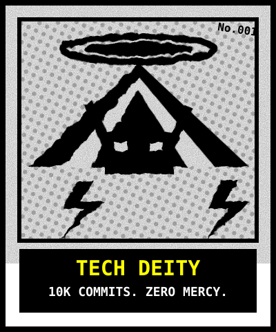
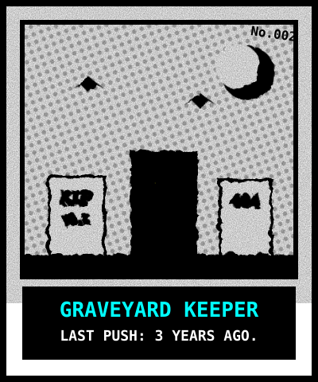
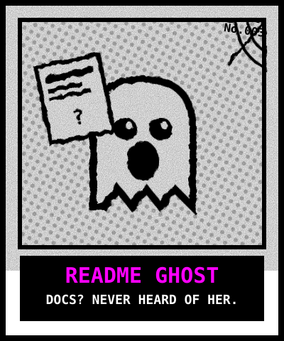
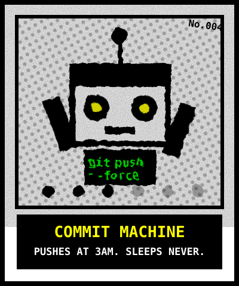
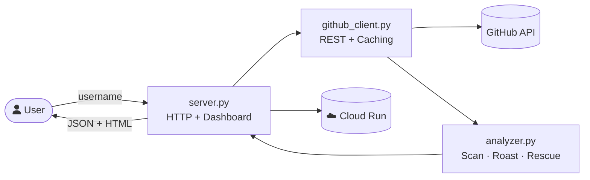

<div align="center">

# 🔥 GitHub Roast & Rescue

**AI-powered GitHub profile analyzer that delivers brutally honest roasts, 30-second recruiter scans, and actionable rescue plans — all in a Neo-Brutalist Bento dashboard.**

[](https://python.org)
[](LICENSE)
[](#-deploy-to-cloud-run)
[](#-design-philosophy)
[](#-design-philosophy)

[Quickstart](#-quickstart) · [Features](#-features) · [Architecture](#-system-architecture) · [API](#-api-reference) · [Deploy](#-deploy-to-cloud-run)

</div>

---

## ⚡ What It Does

Enter any GitHub username → get three things in under 5 seconds:

| Layer | What You Get |
|---|---|
| 👔 **Recruiter Glance** | 30-second summary: stack, repo footprint, contribution signals — the same data a hiring manager scans. |
| 🔥 **The Roast** | A witty, personalized, never-cruel roast mapped to one of 10+ meme archetypes (Tech Deity, README Ghost, Graveyard Keeper…). |
| 🚑 **Rescue Plan** | Three concrete fixes prioritized by effort: a 10-minute quick win, a weekend project, and a career-leverage move. |

**Bonus modes:**

- ⚔️ **Battle Mode** — Enter two usernames for a head-to-head roast arena with side-by-side verdicts and a winner declaration.
- 📋 **Resume vs. Reality** — Compares the user's profile README self-description against their actual repositories and code.
- 🏆 **Wall of Shame** — SQLite-backed leaderboard of all roasted developers, with archetype badges.
- 🔍 **Psych Eval** — Deep behavioral analysis: commit cadence, language loyalty, documentation hygiene, and more.

---

## 🎬 See It In Action

> **System architecture walkthrough (animated):**

https://github.com/user-attachments/assets/github-roast-rescue-3-agent-parallel.webm

The animation above demonstrates the 3-agent parallel architecture powering the analysis pipeline.

---

## 🖼 Meme Archetypes

Each roast assigns a meme archetype. Photocopy-style polaroids spring out with GSAP `back.out(1.7)` easing:

| 👑 Tech Deity | 🪦 Graveyard Keeper | 👻 README Ghost | 🤖 Commit Machine |
|---|---|---|---|
|  |  |  |  |
| God-tier stats | Abandoned repos | Missing docs | Relentless commits |

---

## 🚀 Quickstart

```bash
git clone https://github.com/YOUR_USERNAME/roast-and-rescue.git
cd roast-and-rescue

pip install -r requirements.txt

# Optional: raise GitHub API rate limit from 60 → 5,000 req/hr
export GITHUB_TOKEN=$(gh auth token)  # or paste your PAT

# Launch the dashboard
python server.py
# → http://localhost:8080
```

### CLI

```bash
python main.py              # Start server (default port 8080)
python main.py --port 9090  # Custom port
python main.py --status     # Health check
```

---

## 🏗 System Architecture

High-level system map (auto-adapts to light/dark mode):


> 🔍 For the **interactive explorable version** with trace motion, theme toggle, and PNG/SVG export, open [`architecture.html`](architecture.html) in a browser.

### Request Flow



### Module Responsibilities

| Module | Purpose | Lines |
|---|---|---|
| [`server.py`](server.py) | HTTP server, dashboard HTML/CSS/JS, all route handlers, GSAP animations | ~2800 |
| [`analyzer.py`](analyzer.py) | Profile analysis engine: recruiter scan, roast generation, rescue plan, psych eval, resume audit | ~1170 |
| [`github_client.py`](github_client.py) | GitHub REST API client with caching, rate-limit awareness, `.env` + `gh` CLI token resolution | ~450 |
| [`main.py`](main.py) | CLI entry point, argument parsing, server launcher | ~45 |

---

## 🧩 Features

### Core Analysis Pipeline
- **15+ profile signals** — languages, stars, forks, commit cadence, bio, follower ratios, events, README quality, file structure
- **Cross-repo evidence** — aggregates language bytes across top 5 projects; file tree skeletons from top 3
- **Verified commit telemetry** — grounds analysis in actual pushed code, not just event feed
- **Profile vs. Project README separation** — `{username}/{username}` README treated as resume; code repos analyzed separately

### Web Dashboard
- **Neo-Brutalist Bento Grid** — 12-column masonry, `border-radius: 0`, 6px black borders, CMYK neon accents
- **GSAP Animations** — staggered card entrances (`power4.out`), elastic roast punch, spring meme reveal (`back.out`)
- **Typewriter Effect** — roast text types character-by-character
- **Interactive Stickers** — ducking polaroid memes with hover effects
- **Keyboard Shortcuts** — `Enter` to roast, `Ctrl+K` to focus, `C` to copy terminal output

### Battle Mode (⚔️)
- Two-player head-to-head roast arena
- Side-by-side fighter cards with full analysis
- Winner declaration based on profile strength

### Security
- Input validation against GitHub username regex (`^[a-zA-Z0-9](?:[a-zA-Z0-9-]{0,37}[a-zA-Z0-9])?$`)
- Path traversal protection on `/assets/*`
- No credentials stored in code — token via `$GITHUB_TOKEN` env var or `.env` (gitignored)
- Non-root container user in Dockerfile
- Graceful error handling for all API failure modes

---

## 🔌 API Reference

Base URL: `http://localhost:8080` (or your Cloud Run URL)

### `POST /roast` — Roast a profile

```bash
curl -X POST http://localhost:8080/roast \
  -H "Content-Type: application/json" \
  -d '{"username": "octocat"}'
```

**Response (`200`):**
```json
{
  "status": "success",
  "username": "octocat",
  "recruiter_glance": "…",
  "roast": "…",
  "rescue": "…",
  "psych_eval": "…",
  "resume_vs_reality": {},
  "bento_formatted": "…"
}
```

### `POST /battle` — Head-to-head roast

```bash
curl -X POST http://localhost:8080/battle \
  -H "Content-Type: application/json" \
  -d '{"username1": "torvalds", "username2": "octocat"}'
```

### Other Endpoints

| Method | Path | Purpose |
|---|---|---|
| `GET` | `/` | Neo-Brutalist web dashboard |
| `GET` | `/health` | `{"status":"healthy"}` liveness probe for Cloud Run |
| `GET` | `/leaderboard` | Wall of Shame JSON (top 10 roasted devs) |
| `GET` | `/badge/<user>.svg` | Dynamic Neo-Brutalist README badge |
| `GET` | `/assets/<file>` | Static SVG assets (memes, architecture diagrams) |

**Error Codes:**

| Code | Meaning |
|---|---|
| `400` | Missing/invalid `username` or malformed JSON |
| `404` | GitHub user not found |
| `429` | GitHub API rate limit exceeded |
| `500` | Unexpected server error |

---

## 🗂 Project Structure

```
roast-and-rescue/
├── server.py               # HTTP server + Neo-Brutalist dashboard (HTML/CSS/JS inlined)
├── analyzer.py             # Analysis engine: scan, roast, rescue, psych eval, resume audit
├── github_client.py        # GitHub REST API client (caching, rate limits, token resolution)
├── main.py                 # CLI entry point
├── test_server.py          # Endpoint smoke tests
├── requirements.txt        # Python dependencies
├── Dockerfile              # Production container (Cloud Run ready)
├── cloudbuild.yaml         # Google Cloud Build configuration
├── deploy-cloudrun.sh      # One-click Cloud Run deployment script
├── .env.example            # Environment variable template
├── .gitignore              # Security-first: .env, .db, __pycache__ excluded
├── architecture.html       # Interactive explorable system diagram
├── github-roast-rescue-3-agent-parallel.webm  # Architecture walkthrough animation
└── assets/
    ├── hero-banner.svg     # Animated README hero banner
    ├── demo-roast.svg      # Animated roast demo loop
    ├── architecture.svg    # Light-mode system map
    ├── architecture-dark.svg # Dark-mode system map
    ├── tech-deity.svg      # Meme: god-tier stats
    ├── graveyard-keeper.svg # Meme: abandoned repos
    ├── readme-ghost.svg    # Meme: missing docs
    └── commit-machine.svg  # Meme: relentless commits
```

---

## ⚙ Configuration

| Env Variable | Required | Default | Purpose |
|---|---|---|---|
| `GITHUB_TOKEN` | No | — | Personal access token; lifts rate limit from 60 → 5,000 req/hr |
| `PORT` | No | `8080` | Server bind port (Cloud Run injects this automatically) |

Token resolution order: `$GITHUB_TOKEN` → `.env` file → `gh auth token` CLI fallback.

---

## ☁ Deploy to Cloud Run

### Option 1: Google AI Studio (Recommended)

1. Connect your GitHub repository in Google AI Studio
2. Select "Build & Deploy to Cloud Run"
3. Set `GITHUB_TOKEN` as a secret environment variable

### Option 2: CLI Script

```bash
chmod +x deploy-cloudrun.sh
./deploy-cloudrun.sh
```

### Option 3: Docker + gcloud

```bash
# Build
docker build -t roast-and-rescue .

# Test locally
docker run -p 8080:8080 -e GITHUB_TOKEN=$GITHUB_TOKEN roast-and-rescue

# Deploy
gcloud builds submit --config cloudbuild.yaml
```

The container binds `0.0.0.0:$PORT`, runs as non-root, and exposes all endpoints.

---

## ✅ Testing

```bash
python test_server.py
```

Spins up the server on port `8099`, runs validation against `/health`, `/`, `POST /roast` (schema + error codes), and asset serving.

---

## 🎨 Design Philosophy

- **Neo-Brutalist UI**: `border-radius: 0`, `6px solid #000` borders, `12px 12px 0 #000` hard shadows, CMYK neon palette (`#00ffff`, `#ff00ff`, `#ffff00`)
- **Widescreen Bento Grid**: `95% / 1600px` container; Recruiter + Roast + Terminal above the fold; Rescue spans full width
- **GSAP Motion**: Staggered card entrances (`power4.out`), elastic roast punch, spring meme reveal. No linear CSS transitions
- **Accessibility**: `prefers-reduced-motion` respected; semantic HTML; ARIA labels on interactive elements
- **Zero Frontend Dependencies**: All CSS/JS inlined in `server.py` — no build step, no node_modules

---

## 📜 License

MIT — fork it, roast your friends (kindly), ship the rescue plan.
